# CURIOUS

**Stay curious. Keep growing.**

CURIOUS is a Flutter mobile app that helps **students and interns** discover learning programs, read full details, register and share feedback, while **hosts** organise and manage those programs. It is built as part of the Excelerate Flutter internship.

---

## Table of Contents
1. [Project Vision](#project-vision)
2. [Objectives](#objectives)
3. [Target Users](#target-users)
4. [Features (Week 2 Prototype)](#features-week-2-prototype)
5. [Screenshots](#screenshots)
6. [Demo Video](#demo-video)
7. [Week 3 Changes](#week-3-changes)
8. [Navigation Flow](#navigation-flow)
9. [Design Choices](#design-choices)
10. [Tech Stack](#tech-stack)
11. [Project Structure](#project-structure)
12. [Getting Started](#getting-started)
13. [Roadmap](#roadmap)
14. [Author](#author)

---

## Project Vision
Make learning programs easy to find and easy to run. Students get one calm, simple place to browse programs, see what they involve and share what they think. Hosts get one place to organise programs and understand how learners respond.

## Objectives
- Let students and hosts log in through a **role selector**
- Show a clear list of programs with start dates and short descriptions
- Show full details for each program: description, mentor, schedule and eligibility
- Let students register and give a **star rating and comments**
- Give hosts a dashboard to create and manage programs
- Apply **consistent branding** across every screen with one global theme

## Target Users
| User | What they do |
|---|---|
| **Student / Intern** | Browses programs, reads details, registers and gives feedback |
| **Host** | Organises programs, tracks participation and reads feedback |

## Features (Week 2 Prototype)
- **Login screen** with a Student / Intern and Host role selector, a role-specific tagline and a role-specific button label
- **Home screen** with a welcome message, search box, announcements, featured programs and a bottom navigation bar
- **Program Listing screen** that builds a card for every program from data using `ListView.builder`
- **Program Details screen** showing description, duration, start date, mentor, schedule and eligibility, with Register and Give feedback buttons
- **Feedback screen** with a 5-star rating, a comments box and input validation
- **Host dashboard** with options to create programs, manage programs and view participants and feedback
- **Global theme** for colours, buttons, text fields and app bars
- Data passed between screens (the selected program reaches the Details and Feedback screens)

> This is a front-end prototype. Programs come from sample data in the app, and login does not yet check accounts.

## Screenshots

| Login (Student) | Login (Host) | Home |
|:---:|:---:|:---:|
| 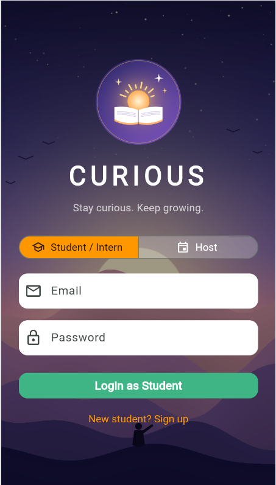 | 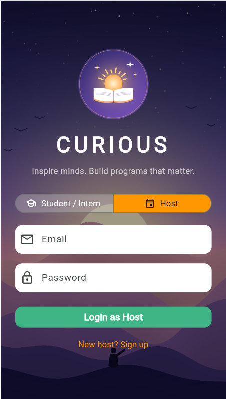 | 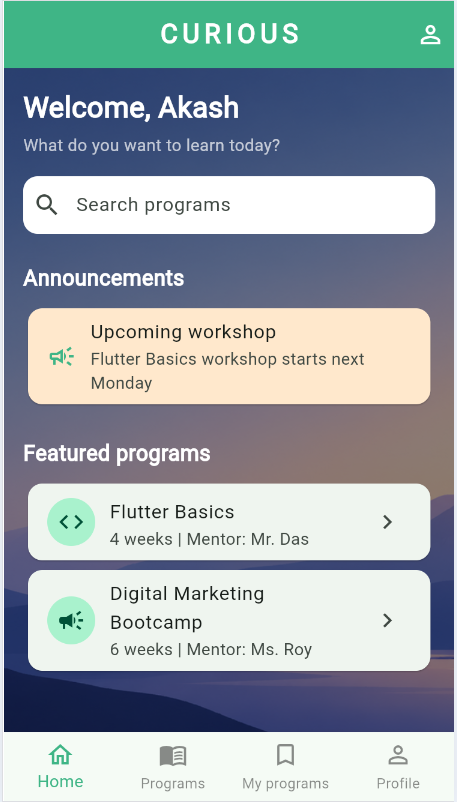 |

| Program Listing | Program Details | Feedback |
|:---:|:---:|:---:|
| 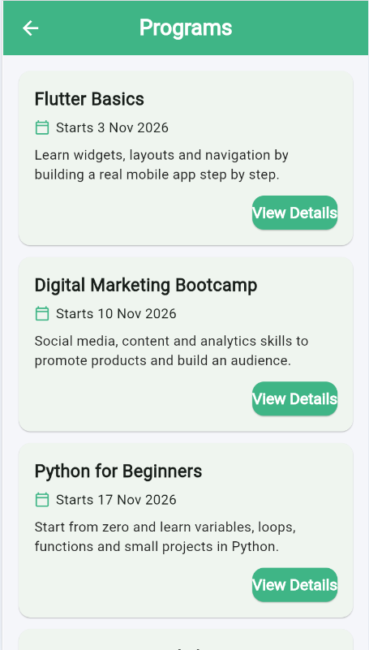 | 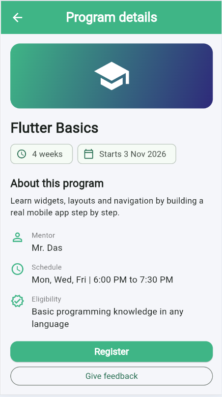 | 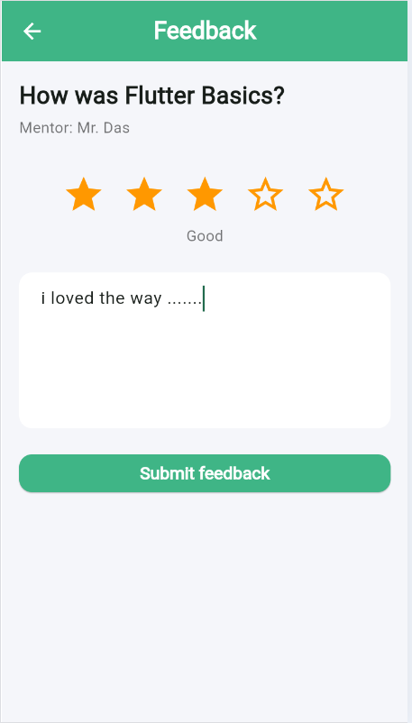 |

| Host Dashboard |
|:---:|
| 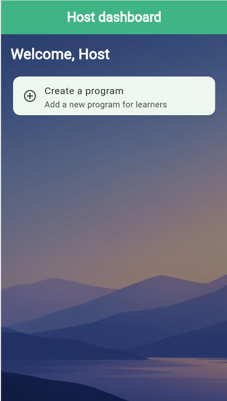 |

## Demo Video
Watch the 2 to 3 minute walkthrough of the navigation between the screens and the design choices:

**[Watch the demo video](https://drive.google.com/file/d/1-Ktaw-hel2rY_NZyjs4z3Sci6lbUUlql/view?usp=sharing)**

## Week 3 Changes
- **Data from JSON:** Program Listing and Program Details now load programs from `assets/data/programs.json` through `ProgramService` and `Program.fromJson`, instead of hardcoded text.
- **Loading and errors:** a spinner while data loads, an error card with a Retry button if loading fails, and a message for an empty list (`FutureBuilder`, `try/catch`).
- **Registration form:** name, email and year of study (dropdown) with validation, a submit spinner, a success message and cleared fields.
- **Feedback form:** star rating, name, email and comments with validation and a success confirmation.
- **Login validation:** the email must be valid and the password needs at least 6 characters.
- **State:** `setState` and `FutureBuilder` keep the screens in sync with the data.


| Loading | Error with Retry | Registration errors |
|:---:|:---:|:---:|
| 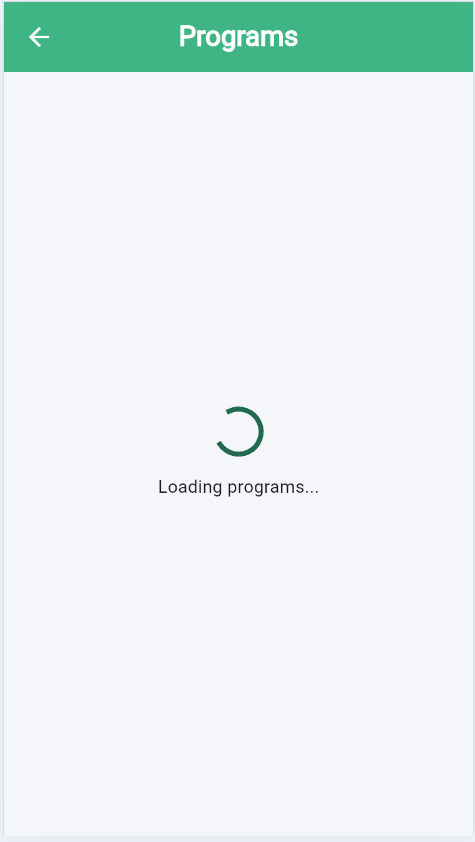 | 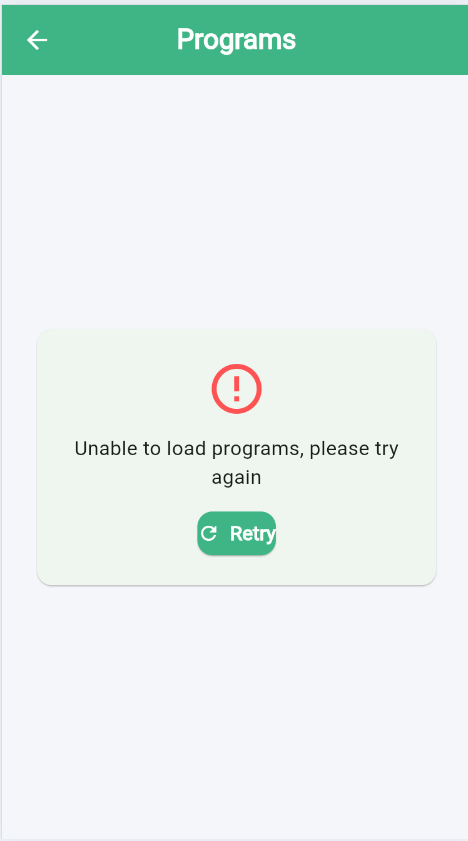 | 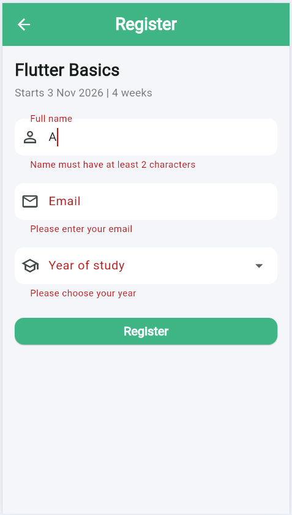 |

| Registration success | Feedback form | Login validation |
|:---:|:---:|:---:|
| 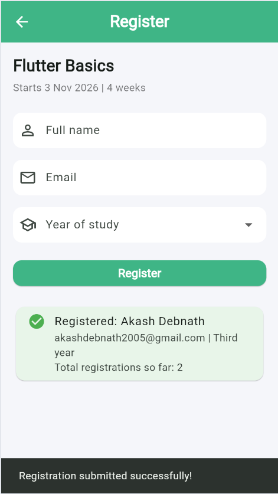 | 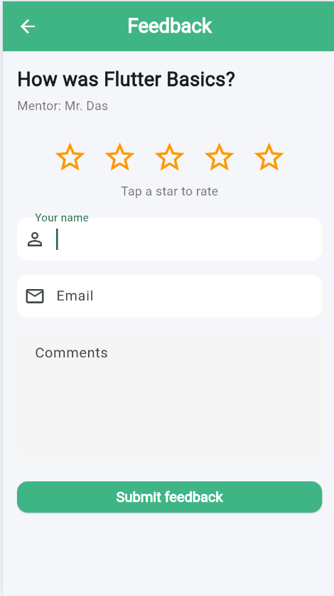 | 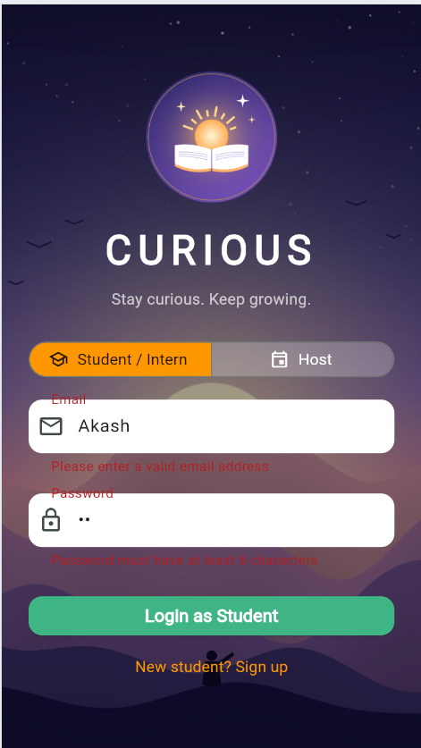 |

## Navigation Flow

```
Student:  Login -> Home -> Program Listing -> Program Details -> Registration / Feedback
Host:     Login -> Host Dashboard
```

- Every screen after Home has a back arrow, so users never get stuck.
- Login uses `pushReplacement`, so the Back button does not return to the login form after signing in.
- The tapped `Program` object is passed to the Details screen and on to the Registration and Feedback screens.

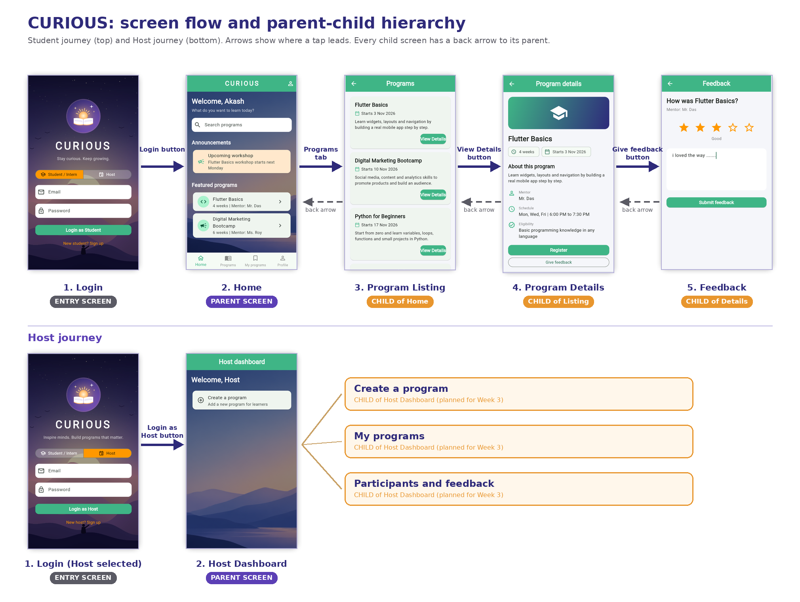

Home is the **parent** screen. Program Listing is a **child of Home**, Program Details a **child of Listing**, and Registration and Feedback are **children of Details**. The Host Dashboard is the parent of the host screens.

## Design Choices
- **Calm sunrise imagery** with a violet and gold feel supports the peaceful, motivating idea behind the name CURIOUS.
- **One global theme** (`ThemeData`) keeps buttons, text fields and app bars consistent on every screen.
- **Cards with short descriptions** make the list easy to scan, and full details live on a separate screen.
- **A role selector** lets each type of user see a fitting message and dashboard.
- **Simple, rounded controls** and clear spacing keep the interface friendly and uncluttered.
- **The layout follows the Week 1 wireframes**: Login, Home, Program Listing and Program Details.

## Tech Stack
- [Flutter](https://flutter.dev) (stable channel) and [Dart](https://dart.dev)
- Material 3 design
- VS Code
- Git and GitHub

## Project Structure

```
flutter_program_app/
├── lib/
│   ├── main.dart                      # App entry point, theme and first screen
│   ├── models/
│   │   ├── program.dart               # Program data class with fromJson
│   │   ├── registration.dart          # Registration data
│   │   └── feedback_entry.dart        # Feedback data
│   ├── services/
│   │   └── program_service.dart       # Loads programs from JSON
│   ├── data/
│   │   ├── sample_programs.dart       # Original sample data
│   │   ├── registrations_store.dart   # Temporary list of registrations
│   │   └── feedback_store.dart        # Temporary list of feedback
│   ├── screens/
│   │   ├── login_screen.dart          # Login with role selector
│   │   ├── home_screen.dart           # Student home
│   │   ├── host_home_screen.dart      # Host dashboard
│   │   ├── program_listing_screen.dart
│   │   ├── program_details_screen.dart
│   │   ├── registration_screen.dart
│   │   └── feedback_screen.dart
│   └── theme/
│       └── app_theme.dart             # Colours and global styles
├── assets/
│   ├── images/                        # Background images and logo
│   └── data/
│       └── programs.json              # Program data loaded by the app
├── docs/
│   └── screenshots/                   # Screenshots used in this README
├── android/  ios/  web/               # Platform folders created by Flutter
├── pubspec.yaml                       # Dependencies and assets
└── README.md
```

## Getting Started

### Prerequisites
- [Flutter SDK](https://docs.flutter.dev/get-started/install) (stable channel)
- Google Chrome (or an Android emulator or phone)
- Git

### Run the app
```bash
git clone https://github.com/akashdebnath-alt/flutter_program_app.git
cd flutter_program_app
flutter pub get
flutter run -d chrome
```

### Try it out
1. On the Login screen, pick **Student / Intern** or **Host**.
2. Enter any email and password (accounts are not checked yet) and tap the login button.
3. As a student: open **Programs** from the bottom bar, tap **View Details**, then **Give feedback**.

## Roadmap
- [x] Week 1: project setup, proposal and wireframes
- [x] Week 2: Login, Home, Program Listing, Program Details and Feedback screens with navigation
- [x] Week 3: data from JSON, loading and error states, registration and feedback forms with validation
- [ ] Connect to a real or mock API with the `http` package
- [ ] Named routes and working bottom navigation tabs
- [ ] My programs and Profile screens
- [ ] Host tools: create, edit and remove programs
- [ ] Real sign-up and login with a backend

## Author
**Akash Debnath**
B.Tech CSE, The ICFAI University, Tripura
Flutter Intern, Excelerate
GitHub: [@akashdebnath-alt](https://github.com/akashdebnath-alt)